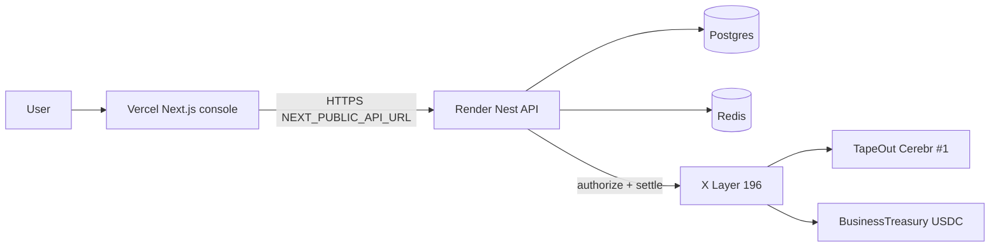

# Production hosting — Render + Vercel

Enterprise topology for AVENZA.

| Layer | Platform | Production value |
|-------|----------|------------------|
| Console | **Vercel** (`apps/web`) | https://avenzafinance.site |
| API | **Render** web (`Dockerfile.api`) | https://avenza-api-7p71.onrender.com |
| Postgres | Render Postgres | wired via `DATABASE_URL` |
| Redis | Render Key Value | wired via `REDIS_URL` |
| Settlement | X Layer **196** | [deployments.md](./deployments.md) |
| DNS | Spaceship → Vercel A/CNAME; optional `api` CNAME → Render | |

Blueprint: [`render.yaml`](../render.yaml) · Vercel: [`apps/web/vercel.json`](../apps/web/vercel.json)  
Env templates: [`apps/api/.env.mainnet.example`](../apps/api/.env.mainnet.example) · [`apps/web/.env.vercel.example`](../apps/web/.env.vercel.example)



---

## Architecture rules

1. **Web never holds** `RELAYER_PRIVATE_KEY`, `ENCRYPTION_KEY`, or DB credentials.  
2. **API is the only process** that signs settlement txs and unwraps custody keys.  
3. **CORS** must list every browser origin (`APP_URL` + `CORS_ORIGINS`).  
4. **Migrations** run on API boot (`scripts/render-api-start.sh` → `prisma migrate deploy`).  
5. Prefer **always-on** Render compute for customer-facing settlement (free tier cold-starts ~1m).

---

## Required secrets (Render API)

Generate once; store in a secrets manager; never commit:

```bash
openssl rand -hex 32   # JWT_SECRET, SESSION_SECRET, INTERNAL_WEBHOOK_TOKEN, ENCRYPTION_KEY
openssl rand -base64 48  # AVENZA_FIELD_ENCRYPTION_KEY
```

| Key | Purpose |
|-----|---------|
| `JWT_SECRET` / `SESSION_SECRET` | Auth |
| `ENCRYPTION_KEY` | Custody + documents + webhook secrets (64 hex) |
| `AVENZA_FIELD_ENCRYPTION_KEY` | Business field crypto |
| `INTERNAL_WEBHOOK_TOKEN` | Worker / internal hooks |
| `RELAYER_PRIVATE_KEY` | Hot wallet ≠ deployer; OKB for gas |
| `REGISTRY_OWNER_PRIVATE_KEY` | Registry Ownable writes |
| `PLATFORM_FEE_RECIPIENT` | Fee destination `0x…` |
| `APP_URL` | `https://avenzafinance.site` |
| `CORS_ORIGINS` | `https://avenzafinance.site,https://www.avenzafinance.site` |
| `API_URL` | Canonical API base (no `/api/v1` suffix) |

Chain and contract addresses are pre-set in `render.yaml`.

---

## Vercel (console)

1. Import GitHub repo · **Root Directory = `apps/web`** (single Next.js service — not multi-service).  
2. Node **22.x**.  
3. Production env:

```bash
NEXT_PUBLIC_API_URL=https://avenza-api-7p71.onrender.com/api/v1
# When api.avenzafinance.site DNS is live, switch to:
# NEXT_PUBLIC_API_URL=https://api.avenzafinance.site/api/v1
NEXT_PUBLIC_XLAYER_CHAIN_ID=196
NEXT_PUBLIC_USDC_TOKEN_ADDRESS=0xB6CEceAB302E2E4948951eE7843FC24E92933061
NEXT_PUBLIC_EXPLORER_TX_BASE=https://www.oklink.com/xlayer/tx
NEXT_PUBLIC_EXPLORER_ADDRESS_BASE=https://www.oklink.com/xlayer/address/
NEXT_PUBLIC_TAPEOUT_PROCESSOR=0xB04EB79D1A5EECaabAAfF7B77d7c27578EE693FF
NEXT_PUBLIC_TAPEOUT_CIRCUIT_ID=1
```

4. Domains: `avenzafinance.site` + `www` → follow Vercel DNS instructions (typically A `@` → `76.76.21.21`, CNAME `www` → `cname.vercel-dns.com`).

---

## DNS (Spaceship)

| Host | Type | Value |
|------|------|--------|
| `@` | A | `76.76.21.21` |
| `www` | CNAME | `cname.vercel-dns.com` |
| `api` | CNAME | `avenza-api-7p71.onrender.com` |

After `api` propagates, add custom domain on Render and update `NEXT_PUBLIC_API_URL` / `API_URL`.

---

## Health & acceptance

```bash
curl -s https://avenza-api-7p71.onrender.com/api/v1/health
# expect: chainId 196, database ok, rpc ok
```

- [ ] Register / login on https://avenzafinance.site  
- [ ] CORS allows console origin (no browser CORS errors)  
- [ ] Relayer funded with OKB  
- [ ] Org vault funded with **native** USDC  
- [ ] 1 USDC smoke settle visible on OKLink  

See [mainnet-go-live.md](./mainnet-go-live.md).

---

## Hardening (enterprise)

| Item | Guidance |
|------|----------|
| Compute | Upgrade Render web off free tier for always-on API |
| Postgres | Paid Render / Neon with backups; free Render DB expires in 30 days |
| Documents | Move `DOCUMENT_ROOT` to object storage (S3-compatible) |
| Keys | Relayer in KMS/HSM; rotate JWT/encryption on schedule |
| Ownership | Transfer Ownable / `EmergencyControl` to multisig |
| Observability | Log drains + uptime checks on `/api/v1/health` |
| Worker | Paid Render worker or separate process for BullMQ when volume grows |
